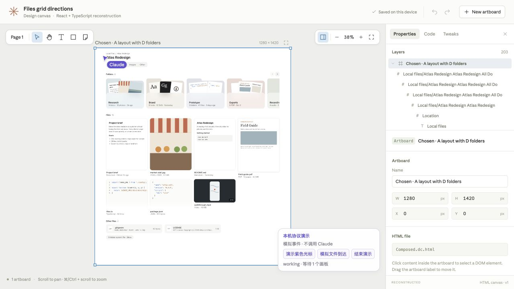
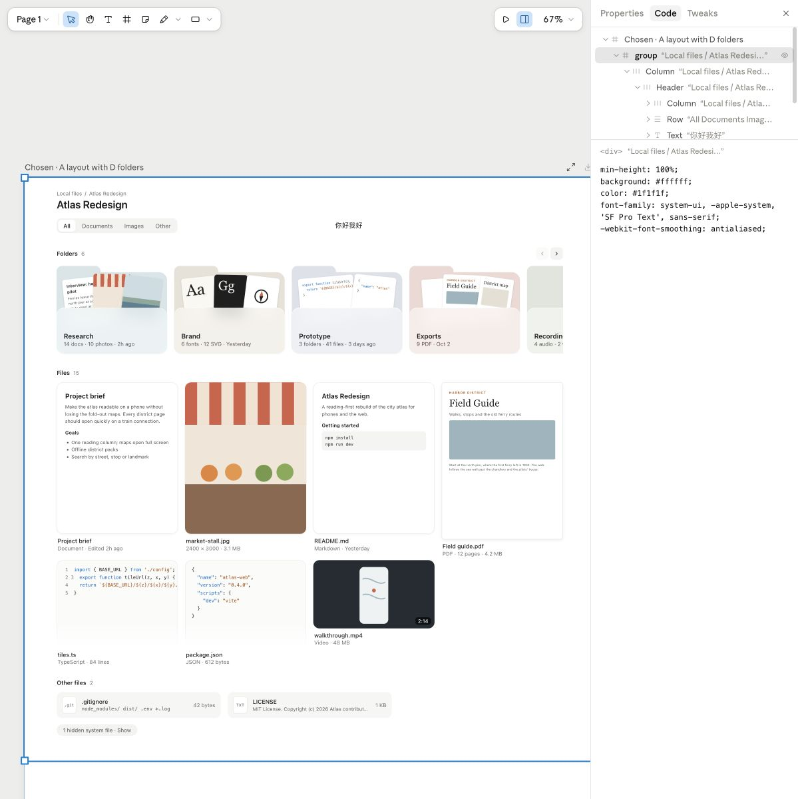
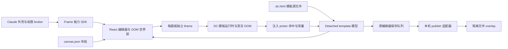

# Claude Design Canvas：反向研究与 React + Vite + TypeScript 还原

对这份 [Claude Design 作品](https://claude.ai/artifact/5ZbyQywWA1edfqHDeTtVZJ#artboard-3a36b3d1734f) 的浏览器前端取证、静态还原和本机回放。研究使用 [morluto/rea](https://github.com/morluto/rea)，分别通过内部浏览器的 CDP 与已登录 Dia 的原生 DevTools 采集，并由多位 Agent 分工、交叉复核。仓库按用户要求公开，供产品同学研究和体验。

主 Demo 是 `demo/` 中可读的 **React + Vite + TypeScript** 源码：独立实现模板模型、HTML iframe、选区、相机、属性/CSS/文字编辑、历史与浏览器保存，不加载捕获的 `app.js` 或 `dc-runtime.js`。`replay/` 另外保留原始编辑器回放，用于核对行为与研究差异。

原站没有提供已观察到的 source map。这里恢复了浏览器发布字节，并依据实际实现重建 TS；不冒充 Anthropic 原始私有 TypeScript 或服务端源码。

## 运行 React 还原版

需要 Node.js 22.22.3+（建议 22 LTS）与 npm。

```sh
git clone https://github.com/DongDongBear/claude-design-canvas-research.git
cd claude-design-canvas-research/demo
npm ci
npm run dev
```

打开 [React + TypeScript 还原版](http://127.0.0.1:5173/)。`npm test` 验证领域/保存/消息契约；`npm run build` 同时检查 TypeScript 和构建宿主、Guest 两个入口。

最小流程：Properties 修改画板 W 并按 Enter → 刷新确认保存；Layers 选择 `h1` → 修改文字并 Apply → Code 修改 inline CSS 并 Apply → Undo / Redo → 刷新。保存位于本浏览器同源 `localStorage` 的版本化 envelope，与原包回放的文件 overlay 相互独立。初始样本只从 `public/reference/` 读取。

可读源码入口：

| 层 | 路径与职责 |
|---|---|
| 绑定 | `src/App.tsx` 把纯 props / intent 绑定到 Service；入口显式注入 I/O |
| 模型 | `src/model/DesignService.ts` 管事实、历史、保存与代次；`TemplateModel.ts` 保留 scaffold 并编辑 detached DOM |
| 界面 | `src/components/`、`src/style.css`，React 宿主与 CSS transform 世界层 |
| 画板 | `src/guest/`、`guest.html`，静态模板、真实 DOM 测量、选区与文字编辑，受限 postMessage |
| 保存 | `src/services/BrowserDesignPort.ts`，同源单 JSON envelope，无账号、模型或云保存 |
| 光标 | `src/activity/`，依据原包紫色 token 和 working / arrival 状态重建；本机协议演示 |

每个 Guest 文档有 revision，模板节点有实例化 tid；旧文档文字不能覆盖新内容，删除后旧节点消息不能命中新节点。布局拖动在松手时提交一次，未将每帧指针更新写入持久化。



浏览器已验证文字/CSS回写、刷新持久化、直接编辑提交/取消、属性撤销/重做及iframe焦点下快捷键；详见 [还原版浏览器证据](evidence/typescript-browser-verification.json)。

## Dia 正版与还原版对标

实际在已登录 Dia 打开同一作品，对照选中画板、h1、Properties、Code、Tweaks、图层、右键菜单和宿主 AI 入口。完整现场记录与缺口在 [Dia 对标](research/dia-comparison.md)；独立复核见 [模型审查](reviews/typescript-model-review.md)、[React / Guest 审查](reviews/typescript-ui-review.md)。逐项差异保留，不把基础功能写成完整产品等价。

## 紫色 Claude 光标与 Agent 如何编辑

原包专属 Claude 箭头的紫色是 **#6250d6**，SVG 为 16×16、白描边 1.2；它由 working 布尔和 awaited 画板 / 文件到达驱动。空画布的游走是前端随机路径动画。协作 presence 另有 `{s,x,y,t,m?}` 实时坐标协议；本次未捕获真实 Agent 发布这类坐标的运行帧。

AI 内容改变主要经远端文件发布 → 版本/冲突核对 → 模板替换 → Guest 更新；Fast Edit 另走流式代码、Worker DOM 副本与 ghost iframe。光标出现不能证明 Agent 在逐像素操纵系统鼠标。精确代码行、颜色、调用点和交叉结论见 [光标深挖](research/agent-cursor.md)、[独立交叉验证](research/agent-editing-crosscheck.md)。本机按钮只演示协议状态，不调用 Claude。

## 运行原始编辑器对照版

原包对照版需要 Python 3.11+，不需要 npm 安装、Claude 登录、API key 或模型额度。

```sh
git clone https://github.com/DongDongBear/claude-design-canvas-research.git
cd claude-design-canvas-research
python3 replay/server.py --port 38471
```

- [原编辑器](http://127.0.0.1:38471/editor/)：选择、图层、属性、Code 面板与本机保存。
- [作品单独运行](http://127.0.0.1:38471/leaf/Composed.dc.html)：直接使用捕获的 DC runtime。
- [入口与说明](http://127.0.0.1:38471/)；[本机运行状态](http://127.0.0.1:38471/__replay/health)。

最小验证流程：点击 Properties → 点击画板标题 → 将 Width 从 1280 改成 1300并回车 → 刷新，重新选择画板确认仍为1300。再选 Layers 内的 group → Code → 修改 `background` → 按 Tab 提交，刷新后检查源文件。修改只写 `replay/state/project/`，原始发布文件不变。恢复初始样本时先停止服务，将 `replay/state/` 移到备份位置，再启动。



浏览器已验证上述尺寸保存、刷新保持，以及 CSS 修改写入 `.dc.html`；验证后恢复了样本尺寸与背景。实际请求、SHA 和结果见 [浏览器证据](evidence/browser-verification.json)。这些是研究 Demo 的 Agent 验证，不是用户对 YouDesktop 产品的桌面验收。

## 原包架构与取证结论



| 问题 | 实码结论 | 证据入口 |
|---|---|---|
| 画布靠什么渲染？ | React 宿主、CSS transform 世界层、每个 artboard 的 HTML iframe；Canvas 主要用于截图/导出 | [画布分析](analysis-canvas/findings.md) |
| 编辑什么事实？ | Detached `<template>` DOM，`data-dc-tpl` 编号，修改模板后序列化为 HTML | 同上 `Vb`/模板章节 |
| 如何选中真实 HTML？ | 注入 picker；命中/测量/contenteditable/拖拽预览，经事件回到宿主提交 | [提取的 picker](analysis-canvas/embedded-scripts/03-string-L86812.js) |
| 作品存在哪里？ | `project/canvas.json` + 每块 `.dc.html`；20个共享类型文件、2个作品文件 | [文件格式分析](analysis-project/findings.md) |
| 如何同步和保存？ | 能力 RPC、文件 ifMatch、版本/seq、同步 WebSocket、DOM replica；本机只替换 publish I/O | [Dia 编辑态与 SDK](analysis-shell/dia-findings.md) |
| Fast Edit 怎么做？ | 模型流式代码 → 隔离 iframe/Happy DOM Worker → 主线程验证并回写模板 | [Worker 与生成链](analysis-project/findings.md)；此账号 flag 实际为 false |

## 文件与覆盖范围

- `recovered-project/`：22个发布文件，共6,073,770字节，全部与独立文件清单的 SHA-256/大小匹配。`index.html` 的 Frame 注入段已无损分离，恢复字节与服务器清单完全一致。
- `project-files/`：匿名 HTTP 下载响应；其中 index 保留注入段，便于对照。`assets/`：外壳、能力 SDK、字体与明确引用的静态依赖，55个匿名 HTTP 资源成功保存。
- `analysis-canvas/`：205,016行格式化主包、13,434行内嵌 picker、运行时分析、符号/协议索引。格式化不恢复原变量名或 TypeScript 类型。
- `analysis-shell/`、`analysis-project/`：外壳、权限、SDK、文件模型与 Worker 的逐行证据。
- `analysis-rea/`：实际运行 REA 6.7.0 的命令、结果和导出绑定；大型JSON公开去标识副本以 `.gz` 归档，原本机hash与公开hash的区别见 archive-manifest。
- `dia/`：仅目标作品的静态资源和裁剪后的编辑态结论。登录 HAR、boot票据、账号数据、原生浏览器截图不提交。
- `reviews/`：互相独立的实现、数据与复现审查；[采集审计](capture-audit.md)保留采集阶段修复记录。
- `demo/`：可读 React + Vite + TypeScript 重建工程与独立契约测试。
- `research/`：Dia现场对标、AI编辑与紫色光标的代码证据。
- `replay/`：原编辑器副本、本机适配器和仅用 Python 标准库的文件服务。`replay/state/` 不进入 Git。

Dia 成功加载的24个 JS、1个 CSS、3个字体均有本地对应；独立解析48种不同 JS 字节序列通过。71条脚本路径未声明 sourceMappingURL，已观察响应也无 SourceMap 头。没有据此声称外部 `.map` 文件绝不存在。

一个外围 Cloudflare 动态脚本在后续抓取时改变；首轮版本不再保留，当前文件版本及该事实明确记在 `asset-manifest.json.initialCapture` 与 `capture/integrity-adjustments.json`。核心编辑器和22个项目文件不受影响。

## 验证与协作

原包验证需要 Node.js 22+ 与 Python；React 工程另按其锁文件安装，CI 固定 Node 22.22.3。

```sh
python3 scripts/verify.py
python3 -m unittest discover -s tests -v
npm --prefix demo test
npm --prefix demo run build
```

CI 使用同一入口。没有截图/像素断言；验证针对字节来源、文件保存、版本冲突、路径范围和同源拒绝行为。多 Agent 的责任与交叉结论见 [协作矩阵](reviews/README.md)。修改我们自己的 adapter/server 后，先跑这些入口，再更新相应证据；捕获的发布文件视为只读输入。

REA 公共语义分析完成 shell 的21/22文件；app、dc-runtime和vendor在1GiB与4GiB heap下仍失败。已使用 REA 自身 parser/traversal 回退，语法解析成功，但不把回退当成完整语义分析或反编译成功。详见 [REA执行记录](analysis-rea/README.md)。

## 边界

本项目恢复浏览器交付的客户端字节和可解释行为，没有取得原始私有 TypeScript 仓库、服务端源码或模型服务。React 还原版当前运行目标静态 `<x-dc>`，保留且不执行 Logic，拒绝非空动态逻辑、绑定与未支持模板。原版完整动态运行时仍保留在对照版。离线 Demo 未提供多人协作、远端 Fast Edit、云资产、云导出、真实账号权限或 Claude 云端保存 ACK；这些能力返回不可用。单文件以临时文件替换保存，但本机多文件 publish 不保证故障/崩溃原子性。

服务绑定127.0.0.1，CSP与适配器限制资源/连接，浏览器验证另外阻断HTTPS/WSS；这不是任意恶意网页的完整断网沙箱。请保持本机运行。原始文件与第三方字体/库版权属于各自权利人，本仓库不为捕获的商业产品资源授予新的许可。
